# 🎯 LOGOS.AI: Agentic AI Debate Coach & Presentation Analytics Platform

[](https://fastapi.tiangolo.com)
[](https://nextjs.org)
[](https://www.python.org)
[](https://react.dev)
[](k8s/)
[](backend/celery_app.py)
[](https://opensource.org/licenses/MIT)

---

## 📑 Table of Contents
- [📖 About](#-about)
- [🏗️ System Architecture](#️-system-architecture)
- [🌟 Core Architectural Features](#-core-architectural-features)
- [🔌 Key API Endpoints](#-key-api-endpoints)
- [🛠️ Technology Stack](#️-technology-stack)
- [🚀 Quick Start (Docker & Local Dev)](#-quick-start-running-locally)
- [☸️ Kubernetes Production Deployment](#️-kubernetes-production-deployment)
- [🔄 CI/CD Pipeline & Security](#-cicd-pipeline--security)
- [📸 Platform UI & Output Screenshots](#-platform-ui--output-screenshots)
- [📁 Repository Structure](#-repository-structure)
- [🧪 Testing & Validation](#-testing--validation)

---

## 📖 About

**LOGOS.AI** is an enterprise, production-grade **Agentic AI Debate Coach & Presentation Analytics Platform**. Engineered for learners, competitive debaters, coaches, educators, and executive speakers, it elevates public speaking and formal argumentation from subjective intuition into a rigorously measured engineering discipline.

### Why LOGOS.AI?
* **Toulmin Analytical Deconstruction**: Automatically decomposes raw arguments into **Claim, Grounds, Warrant, Backing, Qualifier, and Rebuttal**, generating directed visual dependency graphs to isolate weak logical bridges.
* **3-Judge WSDC / BP Championship Swarm**: Simulates a competitive tournament adjudication panel (**Judge Matter**, **Judge Manner**, **Judge Method**) awarding speaker scores on a 60–90 tournament scale with split decisions and justification ballots.
* **Empirical Truth & 20+ Fallacy Matrix**: Extracts statistical assertions for real-time fact verification while scanning arguments against a 20+ cognitive fallacy taxonomy (*Post Hoc, Tu Quoque, Texas Sharpshooter, Equivocation, Fallacy Fallacy*, etc.).
* **Bi-Directional Neural Audio & Prosody**: Computes speaking WPM cadence, silence ratio, acoustic volume variance, and synthesizes AI opponent rebuttals via `edge-tts` (with 100% deterministic offline fallback).
* **Enterprise DevOps & Cloud Scale**: Architected with Celery + Redis distributed queues, Alembic schema migrations, multi-stage hardened Docker containers, Kubernetes HPA manifests, Prometheus metrics, and SAST/CVE-hardened GitHub Actions CI/CD.

---

## 🏗️ System Architecture

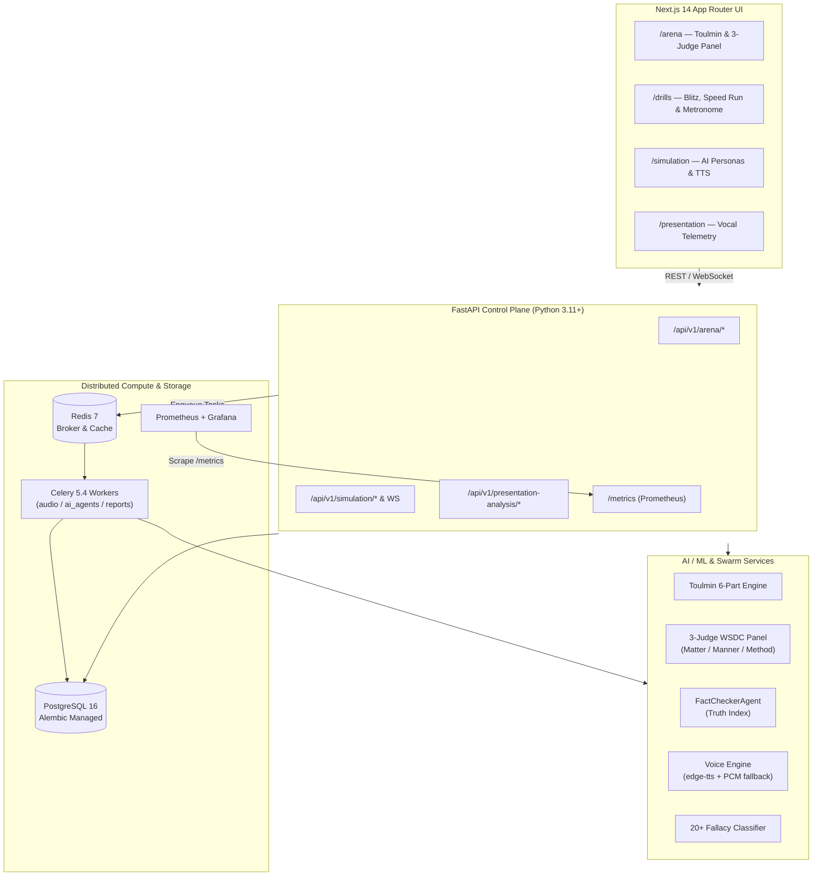

---

## 📸 Platform UI & Output Screenshots

### 1. Landing Page & Feature Overview
> Modern cyber-editorial aesthetic featuring the 8-module suite, scoring matrix, and AI personas.

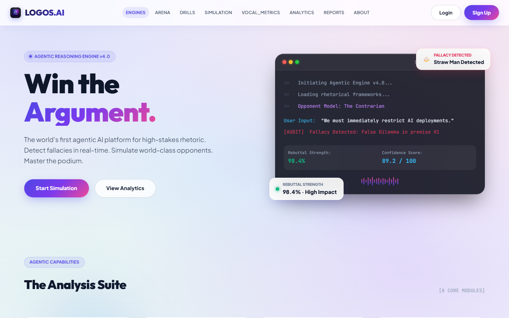

---

### 2. Analysis Suite & Personas
> 8 core modules: Argument Mining, Logic Audit, Rebuttal Gen, Vocal Metrics, Simulation Engine, Weighted Scoring, Coaching Engine, and Analytics Dashboards.

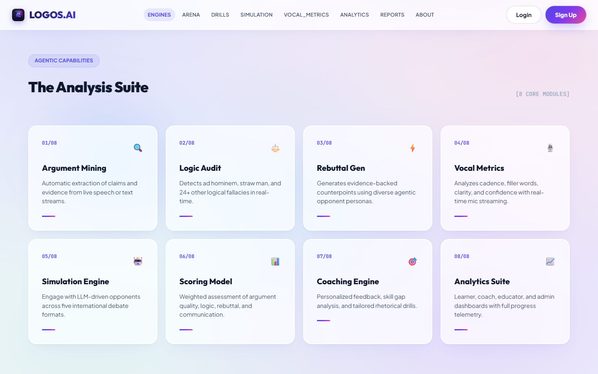
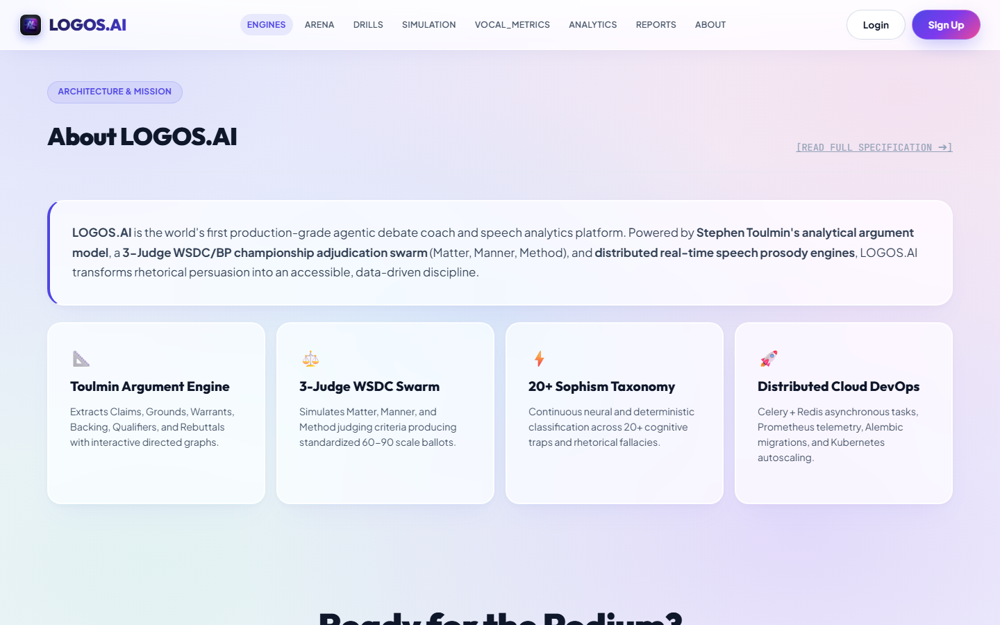

---

### 3. Authentication Flow
> JWT-secured authentication with role-based access control (Learner, Debate Coach, Educator, Administrator) and brute-force lockout protection.

| Sign Up (`/signup`) | Login (`/login`) |
|:---:|:---:|
| 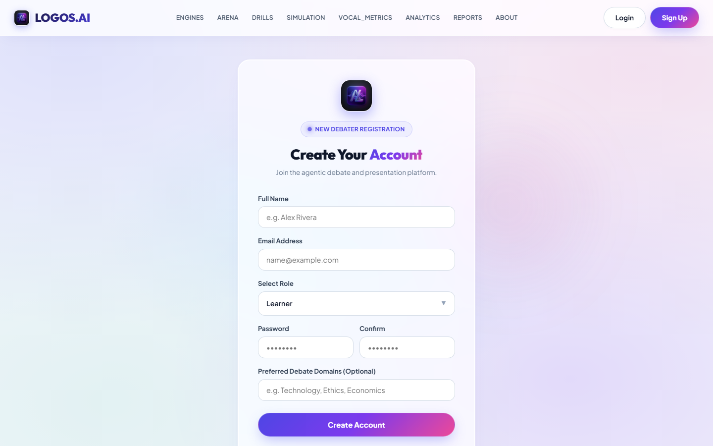 | 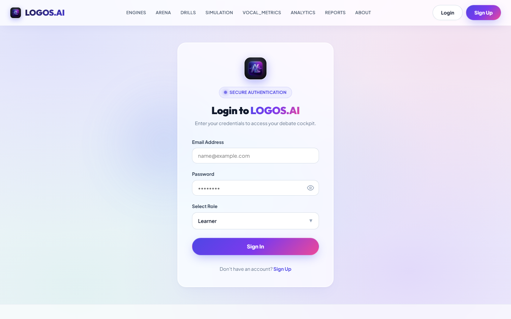 |

---

### 4. Interactive Dashboards & Session Management
> Real-time performance telemetry, session creation, baseline metrics, and history.

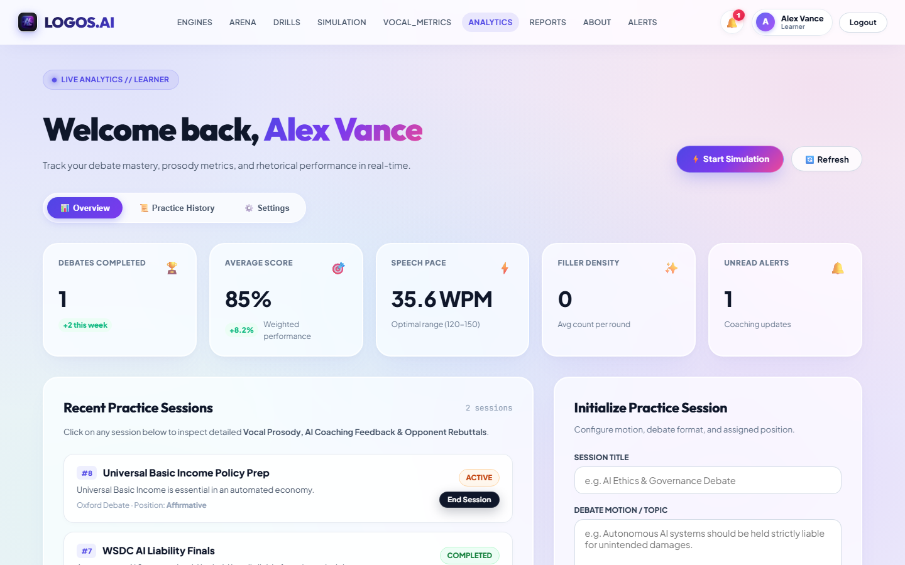
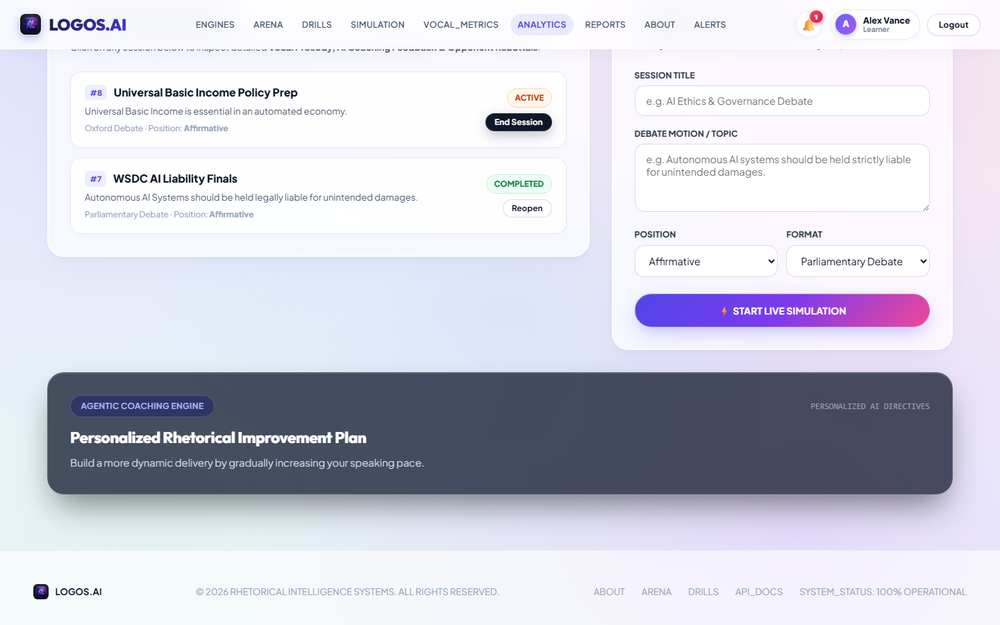

---

### 5. Live AI Debate Simulation Terminal (`/simulation`)
> Multi-turn debate with real-time AI personas (*The Contrarian*, *The Academic*, *The Strategist*), live fallacy detection, rebuttal scoring, and automated coaching tips.

| Simulation Configuration | Live Debate Terminal (Output) |
|:---:|:---:|
| 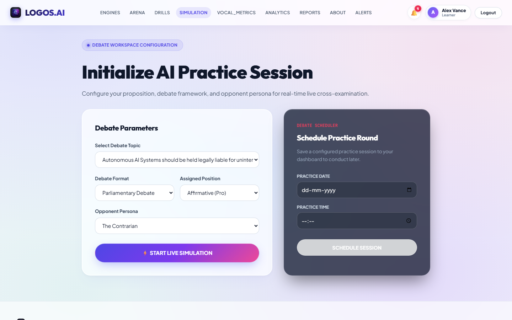 | 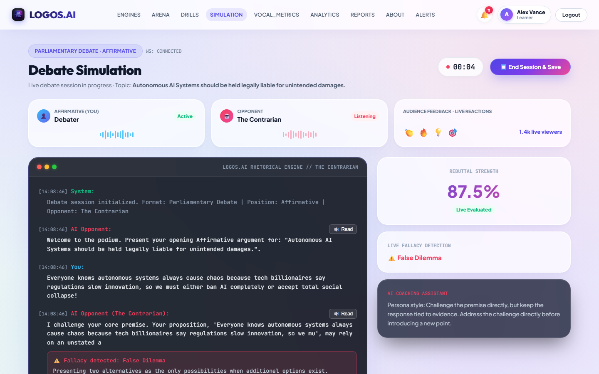 |

---

### 6. Vocal Metrics & Prosody Analysis (`/presentation`)
> Detailed speech evaluation computing Words Per Minute (WPM), filler-word density, confidence score, clarity, and engagement from audio files or transcripts.

| Audio / Transcript Submission | Analytical Output Metrics |
|:---:|:---:|
| 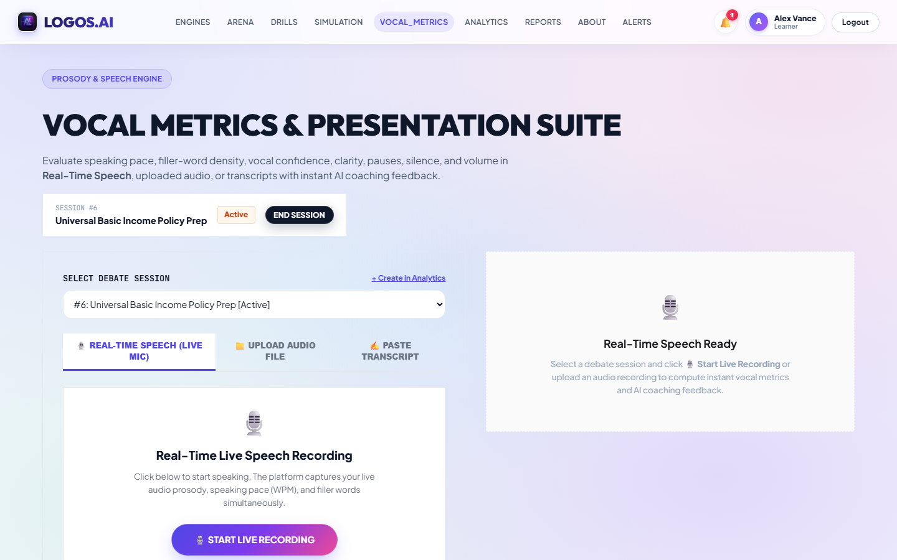 | 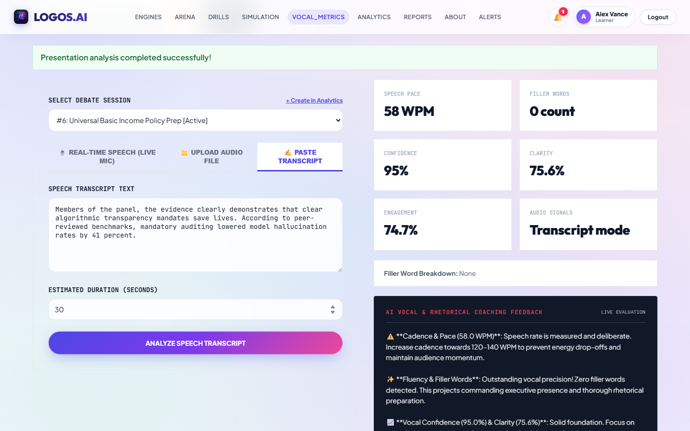 |

---

### 7. Exportable Reports & Verifiable Certificates (`/reports`)
> Downloadable assessment PDFs, 5-dimension Excel workbooks, personalized coaching plans, and verifiable credential verification.

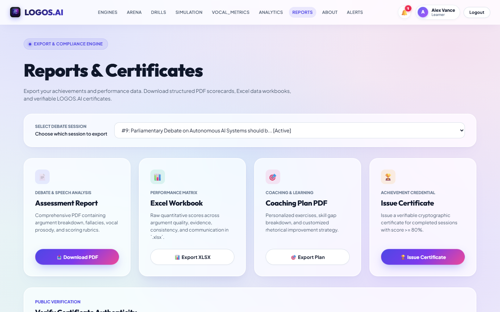

---

### 8. Realtime Alerts & System Notifications (`/notifications`)
> Categorized notifications for milestones, coaching feedback, and scheduled sessions.

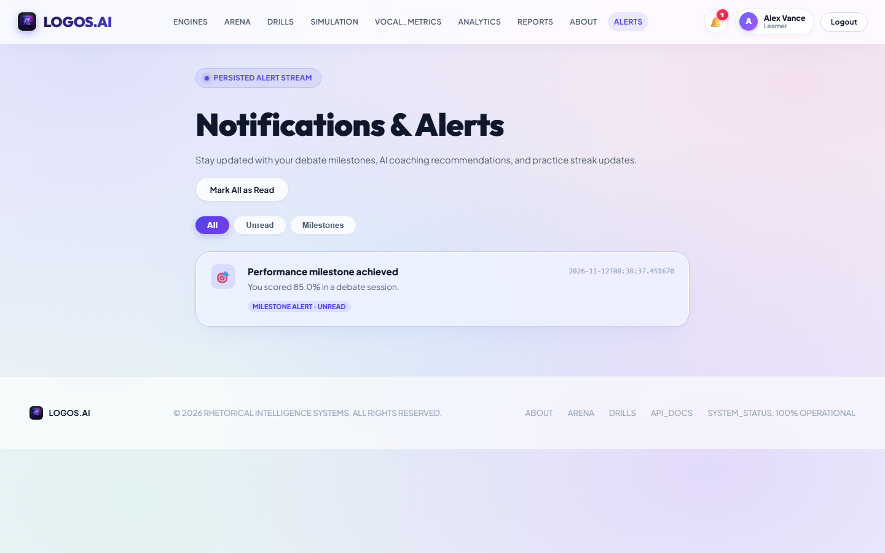

---

### 9. Tournament Arena & Toulmin Graph Visualizer (`/arena`)
> Live competitive debating arena equipped with Toulmin Model 6-part structural argument deconstruction, real-time factual assertion verification, and an official 3-Judge WSDC/BP Adjudication Panel (Matter, Manner, Method).

---

### 10. Rhetorical Drill Gymnasium (`/drills`)
> Gamified rapid-fire training modules featuring 15-second Fallacy Blitz, 30-second Rebuttal Speed Runs, and live Cadence Metronome with WPM biofeedback.

---

### 11. Interactive API Documentation (`localhost:8000/docs`)
> 15 fully-featured Swagger REST API router endpoints with OpenAPI 3.0 schema definitions.

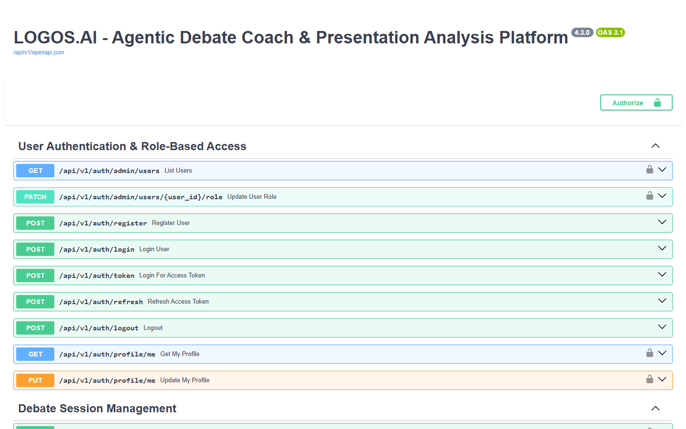

---

## 🌟 Core Architectural Features

1. **Deterministic Local AI Engine (100% Offline Capable)**:
   - Built-in heuristic pattern matching and NumPy vector embeddings.
   - **Zero external API keys required** to run all analysis and simulation features.
   - Optional plug-and-play adapter for OpenAI-compatible LLMs, Groq, and Google Gemini.
2. **Stephen Toulmin Argument Deconstruction Engine**:
   - Decomposes speeches into: **Claim, Data (Grounds), Warrant, Backing, Qualifier, and Rebuttal**.
   - Generates visual directed dependency graphs (`nodes` and `edges`) for interactive analysis.
3. **Multi-Agent 3-Judge Tournament Adjudication Swarm**:
   - **Judge Matter (Content & Logical Rigor)**: Evaluates argumentative depth, substantive evidence, and empirical weight.
   - **Judge Manner (Rhetoric & Delivery)**: Evaluates persuasive ethos, emotional impact, and delivery.
   - **Judge Method (Strategy & Responsiveness)**: Evaluates team strategy, rebuttal prioritization, and structure.
   - Computes official 60–90 scale WSDC ballots with split decisions and speaker margins.
4. **Empirical Fact-Verification Engine**:
   - Regex-driven assertion extractor with numerical, statistical, and citation detectors.
   - Generates an Evidence Truth Index (0–100%) and categorizes unverified empirical claims.
5. **Expanded 20+ Fallacy Classification Taxonomy**:
   - *Ad Hominem, Straw Man, False Dilemma, Slippery Slope, Appeal to Authority, Circular Reasoning, Hasty Generalization, Red Herring, Post Hoc Ergo Propter Hoc, Bandwagon Fallacy, Tu Quoque, Appeal to Emotion, Texas Sharpshooter, Genetic Fallacy, No True Scotsman, Non Sequitur, Appeal to Ignorance, Equivocation, Fallacy Fallacy*.
6. **Distributed Asynchronous Task Processing (Celery + Redis)**:
   - Offloads acoustic analysis, tournament adjudication, and heavy PDF report compilation to dedicated Celery worker pools across segregated queues (`audio`, `ai_agents`, `reports`).
7. **Neural Voice Synthesis Engine**:
   - Generates realistic opponent rebuttals with `edge-tts` and automatic graceful PCM fallback for offline testing.
8. **Enterprise Database Migrations (Alembic)**:
   - Version-controlled schema evolutions with zero data loss.
9. **Observability & Telemetry**:
   - Native Prometheus metric instrumentation exposing `/metrics` with pre-configured scraping and Grafana dashboards.
10. **Multi-Stage Production Docker & Kubernetes (K8s)**:
    - Multi-stage non-root container builds for backend and frontend.
    - Full Kubernetes manifests: PostgreSQL StatefulSet with persistent storage, Redis, Backend with HPA (Horizontal Pod Autoscaler 2–10 replicas), Celery Worker, Frontend, and Ingress with TLS.
11. **Comprehensive CI/CD Pipeline (GitHub Actions)**:
    - Automated Ruff linting, Bandit SAST security scans, Gitleaks secret detection, Pytest test suites, Next.js build validation, and Trivy container vulnerability scanning.

---

## 🔌 Key API Endpoints

| Method | Endpoint | Engine / Service | Description |
|---|---|---|---|
| `POST` | `/api/v1/arena/toulmin/parse` | Toulmin Engine | Decomposes text into Claim, Data, Warrant, Backing, Qualifier, Rebuttal + graph |
| `POST` | `/api/v1/arena/fact-check` | FactCheckerAgent | Audits empirical claims and computes Evidence Truth Index (`0–100%`) |
| `POST` | `/api/v1/arena/match/adjudicate` | 3-Judge WSDC Swarm | Issues official Matter/Manner/Method ballots (`60–90` speaker scale) |
| `POST` | `/api/v1/arena/voice/synthesize` | Voice Engine (`edge-tts`) | Synthesizes persona opponent audio stream (`.mp3`/`.wav`) |
| `POST` | `/api/v1/simulation/turn` | Simulation Engine | Generates contextual persona rebuttals & 20+ fallacy flags |
| `WS` | `/api/v1/simulation/ws/{session_id}` | Realtime WebSocket | Low-latency interactive debate sparring stream |
| `POST` | `/api/v1/presentation-analysis/analyze-audio` | Speech Engine | Computes WPM, RMS energy, pause density & filler ratio |
| `GET` | `/metrics` | Prometheus | OpenMetrics endpoint scraping HTTP latency & throughput |
| `GET` | `/health` | Operations | Live DB connectivity & latency healthcheck |

---

## 🛠️ Technology Stack

| Layer | Technologies |
|---|---|
| **Frontend** | Next.js 14 (App Router), React 18, Vanilla CSS Design System, Lucide Icons |
| **Backend** | FastAPI, Pydantic v2, SQLAlchemy 2.0, Alembic, Uvicorn, WebSockets |
| **Distributed Tasks** | Celery 5.4, Redis 7.2 |
| **Databases** | PostgreSQL 16 (Production), SQLite (Local Fallback), MongoDB (Transcripts) |
| **AI / ML** | Toulmin Engine, Agent Swarm, Heuristic Semantic Hashing, Optional LLM Adapters (Groq / Gemini / OpenAI) |
| **Audio & Voice** | FFmpeg, Edge-TTS, Soundfile, Librosa (Optional Audio Processing) |
| **Reports** | ReportLab (PDF generation), OpenPyXL (Excel workbooks) |
| **Observability** | Prometheus, Grafana, prometheus-fastapi-instrumentator |
| **DevOps & K8s** | Docker Multi-stage, Docker Compose, Kubernetes (StatefulSet, Deployment, HPA, Ingress) |
| **CI / CD** | GitHub Actions (Ruff, Bandit SAST, Gitleaks, Trivy CVE scan, GHCR) |

---

## 🚀 Quick Start: Running Locally

### Prerequisites
* **Python 3.10+** (`python --version`)
* **Node.js 18+** & **npm** (`node --version`)
* **Git**
* *(Optional)* **Docker & Docker Compose** for running the full 7-container stack.

---

### Running via Docker Compose (Recommended Production Stack)

To run the complete production suite including PostgreSQL, Redis, Backend, Celery Worker, Frontend, Prometheus, and Grafana:

```bash
docker-compose up --build
```

Access services:
* **Frontend Application**: `http://localhost:3000`
* **Backend API & Swagger**: `http://localhost:8000/docs`
* **Prometheus Observability**: `http://localhost:9090`
* **Grafana Dashboards**: `http://localhost:3001` (admin / admin)

---

### Step 1: Backend Setup (Local Dev)

1. Open your terminal in the project root:
   ```powershell
   # Create and activate virtual environment
   python -m venv .venv
   
   # Windows:
   .venv\Scripts\Activate.ps1
   # macOS / Linux:
   source .venv/bin/activate

   # Install dependencies
   python -m pip install --upgrade pip
   python -m pip install -r backend/requirements.txt
   ```

2. Configure environment:
   ```powershell
   # Copy template (defaults work 100% offline out-of-the-box)
   cp backend/.env.example backend/.env
   ```

3. Run Alembic Database Migrations:
   ```powershell
   cd backend
   alembic upgrade head
   cd ..
   ```

4. Launch backend server:
   ```powershell
   python -m uvicorn main:app --app-dir backend --host 127.0.0.1 --port 8000 --reload
   ```
   * Backend Health: `http://localhost:8000/health`
   * Prometheus Metrics: `http://localhost:8000/metrics`
   * Swagger API Docs: `http://localhost:8000/docs`

5. *(Optional)* Start Celery Distributed Worker:
   ```powershell
   cd backend
   celery -A celery_app.celery_app worker --loglevel=info -Q default,audio,ai_agents,reports
   ```

---

### Step 2: Frontend Setup

1. Open a **new terminal window** in the project root:
   ```powershell
   cd frontend
   npm install
   npm run dev
   ```
2. Open your browser and navigate to:
   **`http://localhost:3000`**

---

### Step 3: Inspect Database Data (CLI Viewer)

We provide a built-in database inspection utility to view all 18 tables and records directly from your terminal:

```powershell
# List all tables, row counts, and columns
python backend/view_db.py

# View specific table data
python backend/view_db.py users
python backend/view_db.py debate_sessions
python backend/view_db.py simulation_turns
python backend/view_db.py presentation_metrics
python backend/view_db.py fallacy_logs

# Dump entire database summary
python backend/view_db.py all
```

---

## ☸️ Kubernetes Production Deployment

The platform includes production-ready manifests in [`k8s/`](k8s/) configured for declarative deployment, horizontal autoscaling, and TLS ingress:

```bash
# 1. Create dedicated namespace
kubectl apply -f k8s/namespace.yaml

# 2. Deploy secrets and environment config
kubectl apply -f k8s/configmap.yaml

# 3. Deploy stateful backing services (Postgres StatefulSet + PVC & Redis)
kubectl apply -f k8s/postgres.yaml

# 4. Deploy stateless microservices (FastAPI Backend with HPA & Celery Worker)
kubectl apply -f k8s/backend-deployment.yaml
kubectl apply -f k8s/celery-deployment.yaml

# 5. Deploy Ingress routing with automatic Let's Encrypt TLS
kubectl apply -f k8s/ingress.yaml
```

* **Horizontal Pod Autoscaling**: Backend scales dynamically from **2 to 10 replicas** based on CPU/Memory thresholds.
* **Storage Resilience**: PostgreSQL uses a `ReadWriteOnce` 20Gi PersistentVolumeClaim for transaction durability.
* **Zero-Downtime Rolling Updates**: Configured with `maxUnavailable: 0` and `maxSurge: 1`.

---

## 🔄 CI/CD Pipeline & Security

Automated multi-stage pipelines in [`.github/workflows/`](.github/workflows/) enforce quality, security, and supply-chain integrity on every push and pull request:

| Stage | Tooling | Scope |
|---|---|---|
| **Linting & Code Quality** | `ruff` | Fast, deterministic Python syntax & formatting enforcement |
| **Static Security (SAST)** | `bandit` | Automated security vulnerability scanning across backend AST |
| **Secret Detection** | `gitleaks` | Detects accidentally committed API keys, tokens, or credentials |
| **Automated Testing** | `pytest` + `unittest` | Runs offline AI/ML tests, Toulmin engine tests & coverage reports |
| **Frontend Production Build** | `next build` | Compiles and validates all 15 static and dynamic Next.js routes |
| **Container CVE Scan** | `trivy` | Scans production Docker container images for OS/package CVEs |
| **Container Registry** | `GHCR` (GitHub Packages) | Automated multi-arch buildx publishing on releases |

---

## 📁 Repository Structure

```
Agentic-AI-Debate-Coach-Presentation-Analysis-Platform/
├── backend/
│   ├── routers/                # 15 Microservice REST API Endpoints
│   │   ├── arena.py                # Toulmin, 3-Judge Swarm, Fact-Checker & Voice API
│   │   ├── argument_analysis.py
│   │   ├── auth.py
│   │   ├── coaching.py
│   │   ├── dashboards.py
│   │   ├── fallacy_detection.py
│   │   ├── presentation_analysis.py
│   │   ├── reports.py
│   │   ├── simulation.py
│   │   └── ...
│   ├── services/               # Core AI, Speech, Swarm & Security Engines
│   │   ├── agent_swarm.py      # 3-Judge WSDC/BP Panel & FactCheckerAgent
│   │   ├── ai_engine.py        # 20+ Fallacy classifier & Persona engine
│   │   ├── security.py
│   │   ├── speech_engine.py
│   │   ├── toulmin_engine.py   # Stephen Toulmin 6-component argument engine
│   │   └── voice_engine.py     # Edge-TTS Neural voice & PCM tone generator
│   ├── alembic/                # Version-controlled database migrations
│   ├── celery_app.py           # Celery distributed task routing & app instance
│   ├── tasks.py                # Distributed async Celery workers (audio/adjudication)
│   ├── config.py               # Settings & Pydantic env validation
│   ├── database.py             # SQLite/PostgreSQL/MongoDB engine
│   ├── main.py                 # FastAPI Application entrypoint + Prometheus scraper
│   ├── models.py               # SQLAlchemy ORM database models
│   ├── schemas.py              # Pydantic request/response schemas
│   ├── view_db.py              # Built-in database CLI inspection tool
│   └── requirements.txt        # Python backend dependencies
├── frontend/
│   ├── src/
│   │   ├── app/                # Next.js App Router pages
│   │   │   ├── about/          # Platform architecture & mission overview
│   │   │   ├── arena/          # Tournament Arena, Toulmin Graph & Judge Panel
│   │   │   ├── dashboard/      # Role-based analytics dashboards
│   │   │   ├── drills/         # Rhetorical Gymnasium (Fallacy Blitz, Cadence Metronome)
│   │   │   ├── login/          # User login
│   │   │   ├── notifications/  # Alert stream
│   │   │   ├── presentation/   # Vocal metrics suite
│   │   │   ├── reports/        # PDF/XLSX export & verification
│   │   │   ├── signup/         # Account registration
│   │   │   ├── simulation/     # AI debate terminal with voice synthesis
│   │   │   ├── layout.js       # Global layout & single navbar
│   │   │   └── page.js         # Landing page
│   │   ├── components/         # Reusable React components (Navbar, etc.)
│   │   └── lib/api.js          # Unified API client
│   └── package.json
├── k8s/                        # Production Kubernetes Manifests (StatefulSet, HPA, Ingress)
├── monitoring/                 # Prometheus & Grafana scrape configs
├── .github/workflows/          # Enterprise CI/CD pipelines (SAST, CVE, Lint, Buildx)
├── ai-ml/                      # Standalone AI/ML subservice
│   ├── app/                    # Multi-provider LLM routing (Groq/Gemini/Local)
│   └── tests/                  # Offline AI test suite
├── docs/
│   └── screenshots/            # High-resolution UI & output captures
├── docker-compose.yml          # 7-container production orchestration
├── Dockerfile.backend          # Hardened multi-stage non-root backend image
├── Dockerfile.frontend         # Multi-stage optimized Next.js production image
└── README.md
```

---

## 🧪 Testing & Validation

Run comprehensive unit and integration tests across backend, AI swarm, and ML layers:

```powershell
# 1. Toulmin Engine, 3-Judge Swarm & Voice Synthesis tests
python backend/tests/test_arena_engines.py

# 2. Standalone AI/ML offline verification (expanded 20+ fallacies)
python -m pytest -p no:hypothesis -p no:hypothesispytest ai-ml/tests/test_offline.py

# 3. Next.js Frontend Production Build verification
npm run build --prefix frontend
```

---

## 📄 License
This project is licensed under the **MIT License** - see the [LICENSE](LICENSE) file for details.
